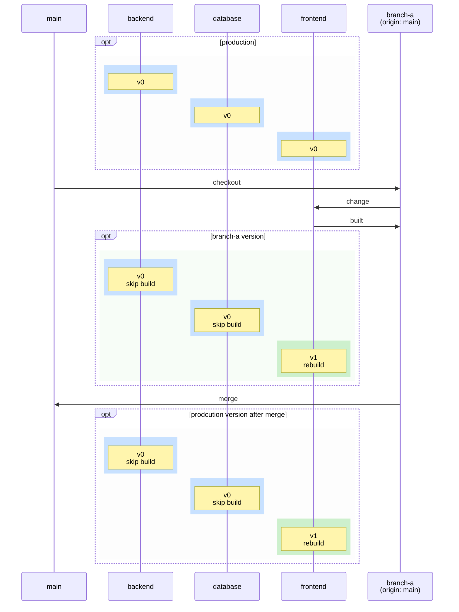
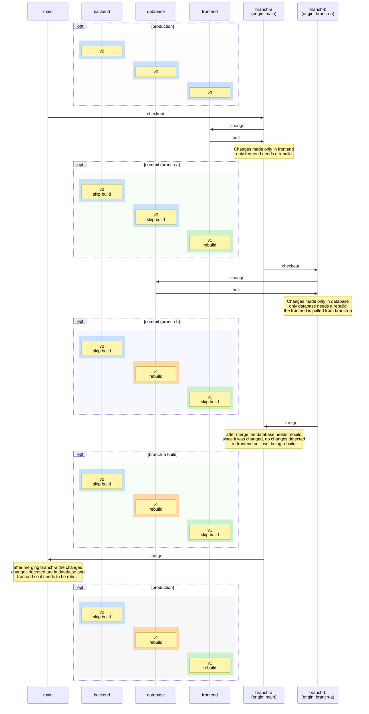
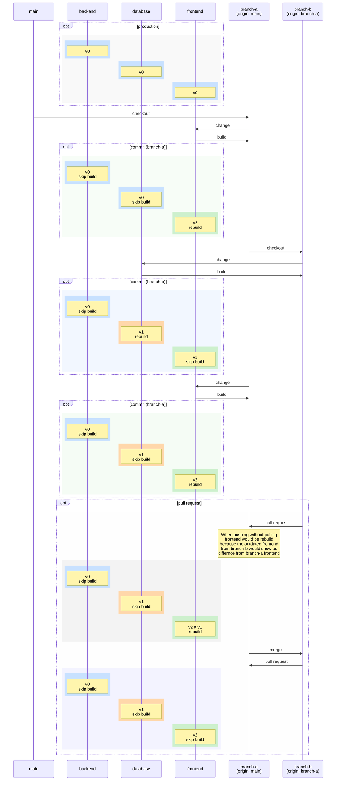

# Monorepo CI/CD Incremental Build Strategy

This document explains how incremental builds, caching, and dependency tracking work in a monorepo containing multiple services (`backend`, `database`, and `frontend`) across different Git branches (`main`, `branch-a`, and `branch-b`).

---

## Overview

In a typical monorepo setup, building the entire project on every commit is inefficient. Instead, modern CI/CD pipelines use **selective/incremental builds** that:
1. Detect which components have changed relative to an origin or parent branch.
2. Rebuild only the modified components.
3. Skip builds (`skip build`) for unchanged services by leveraging cached artifacts or previous versions (`v0`, `v1`, etc.).

---

## 1. Single Branch Modifications (`branch-a`)

When a developer branches off `main` to create `branch-a` and modifies only a single component (e.g., the `frontend`), only that specific component triggers a rebuild.

### Key Takeaways:
- **Backend & Database:** Remain at `v0` and skip builds because no file changes were detected.
- **Frontend:** Upgraded from `v0` to `v1` via a rebuild.
- **Merge to Main:** The changes propagate cleanly to production, carrying over the updated frontend `v1`.

---

## 2. Multi-Level Branching & Cascading Changes (`branch-a` -> `branch-b`)

When working with feature branches derived from other feature branches (e.g., `branch-b` originating from `branch-a`), changes flow downstream. If `branch-b` introduces changes to the `database`, the build system must evaluate what needs updating relative to its parent.

### Flow Breakdown:
1. **`branch-a`**: Updates `frontend` (`v1`), skips backend/database.
2. **`branch-b`**: Branches off `branch-a`, updates `database` (`v1`), while inheriting the existing `frontend` (`v1`) without needing a frontend rebuild.
3. **Merging to `main`**: Cumulative changes from both branches (`database v1` and `frontend v1`) are integrated into production.

---

## 3. Pull Requests, Divergence, and Merge Conflicts Prevention

When parallel development occurs (e.g., `branch-a` receives further updates while `branch-b` is active), handling pull requests requires synchronization to avoid redundant or outdated builds.

### Why Synchronization Matters:
- **Divergence (`v2 ≠ v1`)**: If `branch-a` updates frontend to `v2` while `branch-b` holds an older frontend (`v1`), attempting to merge without syncing will cause the CI system to detect a mismatch and force an unnecessary rebuild.
- **Resolution**: Pulling the latest changes from `branch-a` into `branch-b` aligns versions, allowing the pipeline to safely skip redundant builds (`frontend: v2 skip build`).